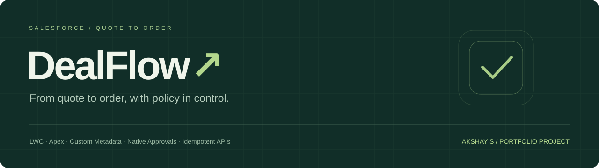
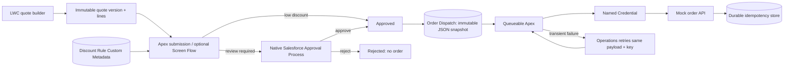

<p align="center"></p>

<p align="center"><strong>Configurable Salesforce approvals. Immutable quote versions. Orders that survive retries.</strong></p>
<p align="center">Lightning Web Components · Apex · Flow · Custom Metadata · Native Approvals · Queueable Apex</p>

DealFlow is a Salesforce portfolio application that takes a sales quote through pricing, discount approval, and delivery to a mock external order system. It focuses on the awkward cases: an invalid rule, a missing manager, a changed approved quote, or an API timeout after an order was already created.

Built by **Akshay S** as an independent learning project using synthetic data. This is a custom quote application; it does not require Salesforce CPQ or Revenue Cloud.

## Try it locally

**No Salesforce account needed for the browser simulation.**

```bash
git clone https://github.com/Akshayy-18/DealFlow-Salesforce-Discount-Approval-Engine.git
cd DealFlow-Salesforce-Discount-Approval-Engine
npm run dev
```

Open **http://127.0.0.1:4173** in your browser. Node.js 20+ is required; there are no npm dependencies to install. Alternatively, double-click [`demo/standalone.html`](demo/standalone.html) for the offline demo.

The browser is explicitly a simulation: role switching is a teaching control, all state resets on reload, and it does not connect to Salesforce or the standalone mock API. The separate Salesforce source implements actual platform access controls and native approvals. No public website has been hosted.

## What it does

| Capability | Implementation |
| --- | --- |
| Quote creation | LWC product lines, quantities, line discounts, gross/net totals; Apex re-reads catalog prices |
| Configurable rules | Custom Metadata defines discount bands and Auto / Manager / Director / Block routing |
| Native approval | Salesforce Approval Process owns manual decisions, locking, and approval history |
| Quote versioning | An approved version stays unchanged; a revision is a new Draft linked to its predecessor |
| Order integration | Approval stages a durable outbox snapshot; Queueable Apex calls a Named Credential |
| Failure recovery | Dispatch status, attempt count, safe error summaries, and operations-only manual retry |
| Duplicate prevention | A unique dispatch key per quote record plus receiver-enforced `Idempotency-Key` |
| Role separation | Sales Rep, Manager, and Operations permission sets with explicit mutation checks |
| Delivery checks | Local tests, metadata checks, Salesforce dry-run validation, and manual deployment workflow |

## The business scenario

Sales reps sell three sample subscription products, priced in INR. Discount policy applies to the **weighted quote discount**, calculated from rounded line totals. The effective discount rounds upward to two decimal places for routing so a slightly-over-limit request cannot fall into a lower band. The net amount remains the exact sum of rounded line nets.

| Discount band | Outcome |
| --- | --- |
| 0–5%, inclusive | Auto-approved |
| Greater than 5%, through 15% | Request owner's manager |
| Greater than 15%, through 25% | Request owner's manager's manager |
| Greater than 25%, through 100% | Submission blocked |

Manual approval is **one stage**, assigned to the resolved person. “Director” means the second user in the manager hierarchy; it is not inferred from a job title. Overlapping rules, missing rules, invalid configuration, inactive approvers, and self-approval fail closed.

## Architecture



The external API enforces the final duplicate boundary. A unique Salesforce outbox row alone cannot prevent duplicates if the external order commits but Salesforce never receives its response. Delivery is **at least once**; the receiving system makes repeated delivery safe.

## A five-minute walkthrough

1. Keep **Sales Rep** selected. Add products and quantities, then try a **3%** discount. The quote auto-approves and an order appears.
2. Try **12%**. Switch to **Sales Manager**, open the request, and approve it. A **20%** request requires **Sales Director** instead.
3. Set the simulated API response to **create order, lose acknowledgement**. Approve another quote. Delivery shows Retryable while the mock order count has already increased.
4. Set the API response back to **Success**, switch to **Operations**, and retry. The order ID is recovered and the external order count stays the same.
5. Switch to **Sales Rep**, open an approved quote, and choose **Create new version**. Change a line and submit it. The old version remains approved; the new one needs fresh evaluation.
6. Try **30%**, an incorrect approval role, or five failed attempts to explore the failure paths.

## Salesforce setup

Use a Developer Edition org or a scratch org with Apex, Flow, and native approvals. Install the official Salesforce CLI, then follow the complete [setup guide](docs/SETUP.md).

```bash
sf org login web --alias DealFlow
sf project deploy start --dry-run --target-org DealFlow --source-dir force-app --test-level RunLocalTests --wait 30
sf project deploy start --target-org DealFlow --source-dir force-app --test-level RunLocalTests --wait 30
sf org assign permset --name DealFlow_Sales_Rep --target-org DealFlow
```

Add **DealFlow Quote Builder** and **DealFlow Order Recovery** to separate Lightning App pages. Configure the user manager hierarchy and the `DealFlow_Order_API` Named Credential before the live integration demo. Salesforce cannot call a localhost API on your laptop; the mock service needs a reachable HTTPS endpoint for a live org callout.

## Tests and CI

```bash
npm test
python tools/check_metadata.py
```

The local suite covers policy boundaries, role decisions, pricing, revisions, retry limits, concurrent API requests, payload conflicts, lost acknowledgements, and idempotency persistence across an API restart. Apex tests cover native manager approval, director rejection, version snapshots, outbox creation, callout mocks, and recovery. [Validation status](docs/VALIDATION.md) records what was actually run; source presence is not a claim of execution or coverage.

[GitHub Actions](.github/workflows/ci.yml) always runs local checks. Salesforce validation requires the repository secret `SF_AUTH_URL_DEV`; without it the workflow reports that org validation did not run. [Manual deployment](.github/workflows/deploy.yml) targets a Developer org through the `salesforce-dev` environment. Configure environment reviewers in GitHub if you want an approval gate.

## Learn the project

- [Learning guide](docs/LEARNING_GUIDE.md): concepts, reading order, exercises, and interview questions
- [Setup and role configuration](docs/SETUP.md): Salesforce, CLI, Named Credentials, and mock API
- [Design decisions](docs/DESIGN.md): access boundaries, snapshots, concurrency, and tradeoffs
- [API contract](docs/API.md): endpoints, idempotency, errors, and failure injection
- [Validation status](docs/VALIDATION.md): checks, results, and remaining prerequisites

```text
force-app/main/default/  Salesforce objects, Apex, LWC, Flow, native approvals, permissions
demo/                   Browser simulation + standalone offline build
mock-api/               Real local HTTP order API and integration tests
docs/                   Setup, design, learning, API, and validation documentation
tools/                  Local preview, deterministic metadata generation, integrity checks
.github/workflows/      Local CI, optional org validation, manual deployment
```

## Intentional boundaries

This is a portfolio implementation, not a production commerce platform. Taxes, currencies other than INR, inventory, cancellation/amendment of existing external orders, and multi-stage approvals are outside scope. An approved revision produces a **separate order**; it does not amend or cancel the previous order. Retries are operator-initiated and stop after five recorded attempts. The mock API is a single-process file-backed service; production needs a transactional store with a unique idempotency constraint.

## Platform references

- [Salesforce native approval APIs](https://developer.salesforce.com/docs/platform/api-rest/guide/resources-process-approvals-post.html)
- [Named Credentials](https://developer.salesforce.com/docs/platform/named-credentials/guide/get-started.html)
- [Salesforce asynchronous processing](https://architect.salesforce.com/docs/architect/fundamentals/guide/async-fundamentals.html)

Independent project by [Akshay S](https://github.com/Akshayy-18). No employer code, customer data, or authentication credentials belong in this repository.
